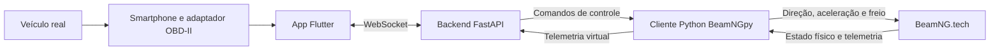

# BeamNG Virtual Twin

O **BeamNG Virtual Twin** é um projeto de gêmeo digital veicular que reproduz o comportamento de um veículo real em uma réplica virtual no BeamNG.tech.

Dados coletados por um aplicativo Flutter, como GPS, IMU e informações OBD-II, são processados por um backend Python com FastAPI. A partir desses dados, o sistema estima o estado do veículo real e envia comandos para um cliente BeamNGpy, responsável por controlar o veículo e coletar telemetria do simulador.

## Visão da arquitetura

### Componentes

- **`app/`**: aplicativo Flutter de coleta de dados do smartphone e do OBD-II.
- **`backend/`**: API FastAPI responsável pela ingestão, validação, processamento, estimação e controle.
- **`beamng-client/`**: cliente Python baseado em BeamNGpy que controla o veículo e a simulação no BeamNG.tech.
- **`architecture-proposal.md`**: especificação técnica completa, incluindo fases, protocolos, dados e critérios de validação.