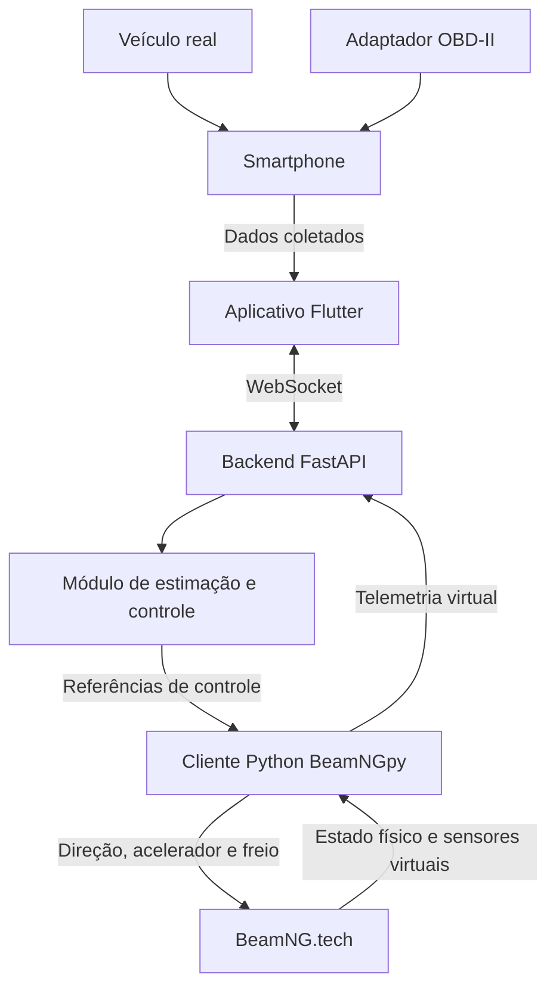
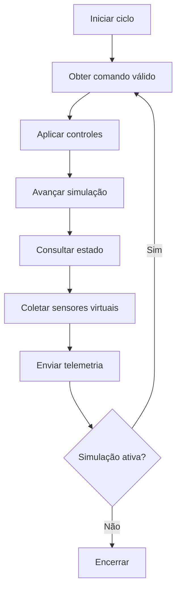
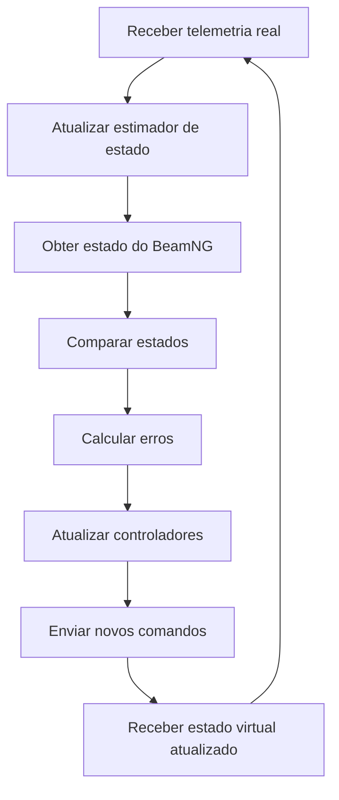

# Projeto de Gêmeo Digital Veicular

Especificação técnica de arquitetura, coleta, processamento e sincronização com BeamNG.tech.

| Item | Valor |
|---|---|
| Versão | 2.0 |
| Simulador | BeamNG.tech |
| Integração | Python + BeamNGpy |
| Backend | Python + FastAPI |
| Aplicativo | Flutter |
| Comunicação | WebSocket |

## 1. Visão geral

O projeto desenvolve um sistema capaz de coletar informações de um veículo real, processá-las e utilizá-las para controlar um veículo virtual no BeamNG.tech.

O veículo real é instrumentado por meio de:

- Smartphone instalado no interior do veículo.
- Adaptador OBD-II conectado à porta de diagnóstico.
- Aplicativo responsável pela coleta e transmissão dos dados.

Os dados são transmitidos por WebSocket para um servidor FastAPI. O backend valida, sincroniza e processa as leituras, estima o estado do veículo real e calcula referências de controle para o cliente Python baseado em BeamNGpy.

O objetivo principal é reproduzir o comportamento do veículo real mantendo a física própria do simulador ativa. Como não há garantia de acesso ao ângulo real do volante ou às velocidades individuais das rodas, o controle utiliza estados estimados a partir dos sensores disponíveis.

### 1.1 Objetivos

- Expandir o aplicativo para coletar dados adicionais do smartphone e do OBD-II.
- Implementar comunicação em tempo real entre o aplicativo e o FastAPI.
- Desenvolver sincronização temporal dos dados.
- Implementar processamento e fusão sensorial.
- Estimar posição, orientação, velocidade, aceleração e trajetória.
- Desenvolver controladores capazes de reproduzir os estados observados.
- Implementar um cliente Python usando BeamNGpy.
- Integrar o cliente ao backend por comunicação bidirecional.
- Obter continuamente o estado físico do veículo virtual.
- Comparar os estados real e virtual e avaliar a fidelidade da reprodução.

### 1.2 Resultado esperado

Ao conduzir o veículo real em uma pista, o veículo virtual deverá reproduzir:

- Posição espacial.
- Orientação.
- Velocidade.
- Aceleração longitudinal.
- Aceleração lateral.
- Taxa de variação de guinada (Yaw Rate).
- Trajetória percorrida.
- Comportamento de aceleração, frenagem e curvas.

Essa reprodução deve usar a física do BeamNG.tech, sem depender exclusivamente de alterações artificiais de posição e orientação.

## 2. Arquitetura geral

A solução é composta por cinco componentes:

1. Aplicativo Flutter de coleta.
2. Backend FastAPI.
3. Módulo de estimação e controle.
4. Cliente Python BeamNGpy.
5. Simulador BeamNG.tech.

### 2.1 Diagrama da arquitetura



### 2.2 Responsabilidades dos componentes

#### Aplicativo Flutter

- Conectar ao adaptador OBD-II.
- Coletar GPS, acelerômetro, giroscópio e orientação.
- Padronizar unidades.
- Registrar timestamps de aquisição.
- Transmitir dados por WebSocket.
- Monitorar conexão e qualidade dos sensores.

#### Backend FastAPI

- Receber os dados do aplicativo.
- Validar os pacotes.
- Organizar leituras temporalmente.
- Sincronizar sensores.
- Processar e filtrar informações.
- Executar fusão sensorial.
- Estimar o estado do veículo real.
- Calcular referências e comandos de controle.
- Receber telemetria do BeamNG.
- Comparar estados reais e virtuais.
- Registrar sessões e indicadores de desempenho.

#### Módulo de estimação e controle

- Converter coordenadas geográficas para coordenadas locais.
- Estimar orientação e trajetória.
- Calcular curvatura e referências de esterçamento.
- Controlar velocidade.
- Comparar o estado real com o virtual.
- Corrigir erros de sincronização.

#### Cliente Python BeamNGpy

- Conectar ao BeamNG.tech.
- Inicializar cenário e veículo.
- Receber comandos do backend.
- Aplicar comandos ao veículo.
- Controlar o avanço da simulação.
- Coletar estado físico e sensores virtuais.
- Transmitir telemetria ao backend.
- Monitorar falhas de comunicação.

#### BeamNG.tech

- Executar a simulação física.
- Calcular a dinâmica do veículo.
- Processar comandos de direção, acelerador e freio.
- Atualizar os estados físicos.
- Disponibilizar informações por meio do BeamNGpy.

## 3. Fase 0 — Evolução do aplicativo de coleta

O aplicativo existente deve ser expandido para coletar os dados necessários ao projeto.

### 3.1 Dados OBD-II

| Informação | PID | Unidade | Prioridade |
|---|---:|---|---|
| Velocidade do veículo | 0D | km/h | Essencial |
| RPM | 0C | rpm | Alta |
| Posição do acelerador | 11 | % | Alta |
| Carga calculada do motor | 04 | % | Média |
| Temperatura do motor | 05 | °C | Baixa |
| Posição absoluta do acelerador | 49, se suportada | % | Média |

Os PIDs devem ser consultados conforme a disponibilidade informada pela ECU. A velocidade geral é suficiente para iniciar a implementação.

### 3.2 Dados GPS

| Informação | Unidade |
|---|---|
| Latitude | graus |
| Longitude | graus |
| Altitude | m |
| Velocidade | m/s |
| Direção de deslocamento | graus |
| Precisão horizontal | m |
| Precisão da velocidade | m/s |
| Timestamp | ms |

### 3.3 Acelerômetro

Coletar os três eixos em m/s²:

- X.
- Y.
- Z.

A frequência desejável é de 50–100 Hz. É necessário compensar a gravidade e transformar os eixos para o referencial do veículo.

### 3.4 Giroscópio

Coletar as rotações X, Y e Z em rad/s. A frequência desejável é de 50–100 Hz.

O eixo Z, transformado para o referencial do veículo, deve ser usado para estimar o Yaw Rate.

### 3.5 Orientação

Utilizar os recursos de orientação disponíveis no sistema operacional:

- Android: `TYPE_ROTATION_VECTOR`, `TYPE_GAME_ROTATION_VECTOR`, `TYPE_ACCELEROMETER` e `TYPE_GYROSCOPE`.
- iOS: Core Motion.

A orientação deve ser usada para transformar as medições da IMU para o referencial do veículo.

### 3.6 Calibração

O smartphone deve permanecer fixo durante a coleta.

A calibração deve identificar:

- Orientação do aparelho.
- Offset do giroscópio.
- Orientação dos eixos.
- Influência da gravidade.
- Convenção de sinais.

### Convenção de sinais recomendada

- X positivo para frente.
- Y positivo para a esquerda.
- Z positivo para cima.
- Yaw positivo para a esquerda.

## 4. Fase 1 — Comunicação com o FastAPI

O aplicativo deve manter uma conexão WebSocket persistente com o backend.

Endpoint sugerido:

```text
ws://servidor:8000/ws/vehicle/{session_id}
```

Em produção, o endpoint deve utilizar WSS.

### 4.1 Estrutura de telemetria

Cada leitura deve possuir seu próprio timestamp de aquisição.

```json
{
  "session_id": "session_001",
  "vehicle_id": "vehicle_001",
  "sequence": 1250,
  "gps": {
    "timestamp": 1794950000125,
    "latitude": -23.55052,
    "longitude": -46.63331,
    "speed": 15.2,
    "heading": 120.5,
    "horizontal_accuracy": 3.0
  },
  "imu": {
    "timestamp": 1794950000120,
    "accelerometer": {
      "x": 0.45,
      "y": 1.20,
      "z": 9.81
    },
    "gyroscope": {
      "x": 0.01,
      "y": 0.02,
      "z": 0.18
    }
  },
  "obd": {
    "timestamp": 1794950000115,
    "speed": 15.0,
    "rpm": 3200,
    "throttle_position": 35
  }
}
```

Os valores são ilustrativos.

### 4.2 Requisitos

- Reconexão automática.
- Controle de sequência.
- Identificação de pacotes perdidos.
- Controle de latência.
- Monitoramento da disponibilidade dos sensores.
- Buffer local.
- Identificação da sessão.
- Registro de falhas.

## 5. Fase 2 — Processamento e fusão sensorial

O backend deve processar os dados em etapas independentes.

### 5.1 Padronização

Todas as unidades devem ser convertidas para:

- Velocidade: m/s.
- Aceleração: m/s².
- Rotação: rad/s.
- Ângulo: rad.
- Distância: m.
- Tempo: s.

Conversão da velocidade:

\[
v_{m/s} = \frac{v_{km/h}}{3.6}
\]

### 5.2 Transformação de coordenadas

- Transformar os dados da IMU para o referencial do veículo.
- Compensar a gravidade no acelerômetro.
- Converter latitude e longitude para coordenadas locais ENU.

### 5.3 Sincronização temporal

O backend deve:

- Organizar leituras pelos timestamps.
- Identificar leituras atrasadas.
- Interpolar quando apropriado.
- Identificar dados ausentes.
- Produzir estados com timestamp de referência.

### 5.4 Fusão sensorial

Implementar inicialmente um filtro complementar e, posteriormente, um EKF.

Estado sugerido:

\[
X = [x,\ y,\ v,\ \psi,\ r,\ a_x,\ a_y]^T
\]

Onde:

- `x/y`: posição.
- `v`: velocidade.
- `ψ`: orientação.
- `r`: Yaw Rate.
- `a_x`: aceleração longitudinal.
- `a_y`: aceleração lateral.

O estimador deve considerar a incerteza dos sensores e utilizar a velocidade OBD como referência.

## 6. Fase 3 — Estimativa de trajetória e direção

### 6.1 Orientação

\[
\psi_t = \psi_{t-1} + r\Delta t
\]

A orientação estimada deve ser corrigida utilizando informações do GPS e da fusão sensorial.

### 6.2 Curvatura

\[
\kappa = \frac{r}{v}
\]

A estimativa deve ser limitada ou desconsiderada em velocidades muito baixas e comparada com a curvatura calculada a partir da trajetória GPS.

### 6.3 Ângulo de esterçamento

Utilizar inicialmente o modelo cinemático de bicicleta:

\[
\delta = \arctan(L\kappa)
\]

Onde `L` representa o entre-eixos do veículo virtual.

### 6.4 Construção da trajetória

Cada ponto da trajetória deve conter:

- Timestamp.
- Coordenadas X e Y.
- Orientação.
- Velocidade.
- Curvatura.
- Aceleração longitudinal.
- Aceleração lateral.

## 7. Fase 4 — Controle do veículo virtual

O controle deve utilizar uma arquitetura em malha fechada.

### 7.1 Comparação de estados

Estados reais:

- Posição.
- Orientação.
- Velocidade.
- Aceleração.
- Yaw Rate.
- Curvatura.

Estados virtuais:

- Posição.
- Orientação.
- Velocidade.
- Aceleração.
- Yaw Rate.
- Esterçamento aplicado.

Erros:

\[
e_x = x_{real} - x_{virtual}
\]

\[
e_y = y_{real} - y_{virtual}
\]

\[
e_v = v_{real} - v_{virtual}
\]

\[
e_\psi = \psi_{real} - \psi_{virtual}
\]

Os erros espaciais devem ser calculados no mesmo referencial.

### 7.2 Direção

Utilizar Pure Pursuit inicialmente:

\[
\kappa_d = \frac{2\sin(\alpha)}{L_d}
\]

\[
\delta_d = \arctan(L\kappa_d)
\]

O controlador deve considerar a velocidade para ajustar a distância de antecipação.

### 7.3 Velocidade

Um controlador PID pode calcular os comandos de aceleração e frenagem.

### 7.4 Dinâmica

Aceleração longitudinal, aceleração lateral e Yaw Rate devem ser usados como referências adicionais para avaliar e ajustar o comportamento.

O controlador não deve simplesmente impor essas acelerações ao veículo virtual. A dinâmica do simulador deve permanecer ativa.

## 8. Fase 5 — Cliente Python BeamNGpy

Esta fase implementa a comunicação entre o FastAPI e o BeamNG.tech.

O cliente deve ser independente do backend e pode ser executado na mesma máquina do simulador.

### 8.1 Responsabilidades

- Inicializar o BeamNG.tech.
- Conectar usando BeamNGpy.
- Carregar o cenário.
- Posicionar o veículo.
- Configurar os sensores virtuais.
- Receber comandos do backend.
- Aplicar controles.
- Avançar a simulação.
- Coletar estados físicos.
- Enviar telemetria ao backend.

### 8.2 Estrutura sugerida

```text
beamng_client/
├── main.py
├── beamng_connection.py
├── scenario_manager.py
├── vehicle_controller.py
├── telemetry_collector.py
├── websocket_client.py
├── simulation_loop.py
├── sensor_manager.py
└── config.py
```

### 8.3 Integração com BeamNGpy

A comunicação com o simulador deve utilizar a API oficial BeamNGpy.

Principais recursos:

- Conexão com o simulador.
- Gerenciamento de cenário.
- Gerenciamento do veículo.
- `Vehicle.control()` para aplicação de comandos.
- `Vehicle.state` para consulta do estado.
- Sensores virtuais.

| Sensor | Utilidade |
|---|---|
| Electrics | Acelerador, freio e dados elétricos |
| GForces | Acelerações |
| Timer | Tempo da simulação |
| AdvancedIMU | Informações inerciais |
| Estado do veículo | Posição, velocidade e orientação |

A disponibilidade e os campos específicos devem ser confirmados na versão instalada do BeamNGpy.

Documentação:

- [BeamNGpy](https://beamngpy.readthedocs.io/)
- [BeamNG.tech](https://www.beamng.tech/)

### 8.4 Ciclo de simulação



### 8.5 Controle do tempo

Como referência inicial, usar:

\[
\Delta t = 0.01\ s
\]

Isso representa um passo de 10 ms, equivalente a 100 passos por segundo. O valor deve ser validado conforme a capacidade de processamento e a configuração da simulação.

O ciclo deve usar os mecanismos de avanço controlado de tempo disponibilizados pela versão do BeamNGpy instalada.

O envio e recebimento de dados pela rede não deve determinar o avanço físico do simulador.

Caso o backend não envie um novo comando dentro do prazo, o cliente deve aplicar uma política definida de último comando válido, limite de validade e comportamento seguro.

### 8.6 Organização dos processos

Recomenda-se executar:

- Aplicativo no smartphone.
- FastAPI como processo de servidor.
- BeamNG.tech como processo de simulação.
- Cliente BeamNGpy como processo independente.

Essa separação facilita testes, reinicializações e manutenção.

## 9. Fase 6 — Comunicação bidirecional FastAPI e BeamNGpy

O cliente BeamNGpy e o backend devem manter uma conexão persistente.

Endpoint sugerido:

```text
ws://servidor:8000/ws/simulator/{session_id}
```

O protocolo deve suportar mensagens de controle, telemetria, sincronização e status.

### 9.1 Comandos enviados pelo backend

```json
{
  "type": "control_command",
  "session_id": "session_001",
  "sequence": 1250,
  "reference_timestamp": 1794950000125,
  "valid_until": 1794950000225,
  "simulation_dt": 0.01,
  "control": {
    "steering": 0.12,
    "throttle": 0.35,
    "brake": 0.0
  }
}
```

Os valores são ilustrativos. Os controles devem respeitar a convenção e os limites esperados pelo BeamNGpy.

O comando deve possuir validade temporal para evitar a aplicação de referências antigas.

### 9.2 Telemetria enviada pelo cliente BeamNG

```json
{
  "type": "virtual_telemetry",
  "session_id": "session_001",
  "sequence": 1250,
  "simulation_time": 12.50,
  "wall_time": 1794950000135,
  "vehicle_state": {
    "position": {
      "x": 125.2,
      "y": 82.0,
      "z": 0.4
    },
    "orientation": {
      "yaw": 1.23,
      "pitch": 0.01,
      "roll": 0.02
    },
    "velocity": {
      "x": 14.7,
      "y": 1.5,
      "z": 0.0
    },
    "acceleration": {
      "longitudinal": 0.42,
      "lateral": 1.15
    },
    "yaw_rate": 0.17
  },
  "controls_applied": {
    "steering": 0.12,
    "throttle": 0.35,
    "brake": 0.0
  }
}
```

Os campos devem ser mapeados a partir das estruturas efetivamente retornadas pelo BeamNGpy.

### 9.3 Separação entre tempo simulado e tempo real

Tempo simulado:

- Representa a evolução física dentro do BeamNG.tech.
- Deve ser monotônico dentro da sessão.

Tempo real:

- Representa o horário de aquisição e transmissão dos dados.
- Deve ser usado para calcular latência.

O backend deve registrar a relação entre tempo real e tempo simulado.

### 9.4 Política de comunicação

O protocolo deve contemplar:

- Número sequencial das mensagens.
- Timestamp de referência.
- Timestamp de validade do comando.
- Identificação da sessão.
- Identificação do tipo de mensagem.
- Confirmação de conexão.
- Detecção de mensagens atrasadas.
- Recuperação após desconexão.
- Monitoramento de latência.

Comandos antigos não devem ser aplicados indiscriminadamente.

## 10. Fase 7 — Sincronização entre veículo real e virtual

O objetivo é manter os dois veículos sincronizados.

### 10.1 Fluxo de sincronização



### 10.2 Estratégia de controle

A estratégia deve combinar:

- Pure Pursuit para acompanhamento da trajetória.
- PID para velocidade.
- Controle de orientação.
- Correção de erros espaciais.
- Monitoramento da dinâmica lateral.

A física do BeamNG.tech deve permanecer ativa.

O objetivo não é sobrescrever diretamente posição e orientação a cada atualização, mas reduzir os erros por meio de comandos físicos compatíveis com o veículo virtual.

### 10.3 Compensação de latência

A comunicação entre smartphone, servidor e simulador introduz atrasos.

É necessário:

- Medir a latência total.
- Identificar a idade de cada referência.
- Usar timestamps para alinhar os estados.
- Prever o estado de referência quando necessário.
- Limitar a aplicação de comandos atrasados.

A previsão deve ser limitada ao horizonte em que o modelo de movimento permanecer confiável.

## 11. Fase 8 — Persistência e validação

Todas as sessões devem ser armazenadas.

### 11.1 Dados armazenados

- Telemetria original do OBD.
- Telemetria original do GPS.
- Dados originais da IMU.
- Dados processados.
- Estados estimados.
- Trajetória real.
- Comandos enviados ao BeamNG.
- Estado físico retornado pelo BeamNG.
- Tempo simulado.
- Tempo real.
- Latência.
- Pacotes perdidos.
- Erros de sincronização.

Os dados originais devem ser preservados separadamente dos dados processados.

### 11.2 Indicadores

| Indicador | Objetivo |
|---|---|
| Erro de posição | Diferença espacial |
| Erro de orientação | Diferença angular |
| Erro de velocidade | Diferença de velocidade |
| Erro de aceleração | Diferença dinâmica |
| Erro de Yaw Rate | Diferença de rotação |
| Latência | Atraso real-virtual |
| Pacotes perdidos | Qualidade da comunicação |
| Tempo de processamento | Desempenho do backend |
| Tempo de passo | Desempenho da simulação |

### 11.3 Testes

- Veículo parado.
- Trajeto em linha reta.
- Curvas abertas.
- Curvas fechadas.
- Aceleração.
- Frenagem.
- Sessão completa.

Cada etapa deve validar estimação, controle e sincronização antes de avançar para a seguinte.

## 12. Estrutura final sugerida do projeto

```text
digital_twin/
├── app/
│   ├── obd/
│   ├── gps/
│   ├── imu/
│   ├── calibration/
│   └── websocket/
├── backend/
│   ├── app/
│   │   ├── main.py
│   │   ├── api/
│   │   ├── models/
│   │   ├── ingestion/
│   │   ├── processing/
│   │   ├── trajectory/
│   │   ├── control/
│   │   ├── simulator/
│   │   └── storage/
│   └── tests/
├── beamng_client/
│   ├── main.py
│   ├── beamng_connection.py
│   ├── scenario_manager.py
│   ├── vehicle_controller.py
│   ├── telemetry_collector.py
│   ├── websocket_client.py
│   ├── simulation_loop.py
│   ├── sensor_manager.py
│   └── config.py
├── shared/
│   ├── schemas/
│   ├── protocols/
│   └── constants/
└── documentation/
    ├── architecture.md
    ├── data_dictionary.md
    └── integration.md
```

## 13. Cronograma lógico de desenvolvimento

| Fase | Entrega |
|---:|---|
| 0 | Aplicativo expandido |
| 1 | Comunicação do aplicativo com FastAPI |
| 2 | Processamento e fusão sensorial |
| 3 | Estimador de trajetória |
| 4 | Controladores de direção e velocidade |
| 5 | Cliente BeamNGpy |
| 6 | Comunicação bidirecional com BeamNG |
| 7 | Sincronização dos veículos |
| 8 | Validação e otimização |

A integração com o BeamNG pode começar em paralelo com o desenvolvimento do processamento dos sensores, utilizando comandos e trajetórias simulados para validar a comunicação.

## 14. Diretrizes finais

O sistema deve manter uma separação clara entre aquisição, estimação, controle e simulação.

- O aplicativo é responsável pela coleta.
- O FastAPI é responsável pelo processamento, estimação e controle.
- O cliente BeamNGpy é responsável pela execução dos comandos e coleta de telemetria virtual.
- O BeamNG.tech é responsável pela simulação física.

A comunicação entre os componentes deve utilizar timestamps, identificadores de sessão e números sequenciais.

A fidelidade do gêmeo digital depende principalmente de:

- Qualidade dos dados coletados.
- Sincronização temporal.
- Precisão da estimativa de movimento.
- Calibração física do veículo virtual.
- Estabilidade dos controladores.
- Baixa latência e previsibilidade da integração.

**Diretriz principal:** o veículo real deve funcionar como referência de movimento, enquanto o BeamNG.tech reproduz esse comportamento por meio de sua própria simulação física, com o backend continuamente estimando e corrigindo as diferenças entre os dois veículos.
